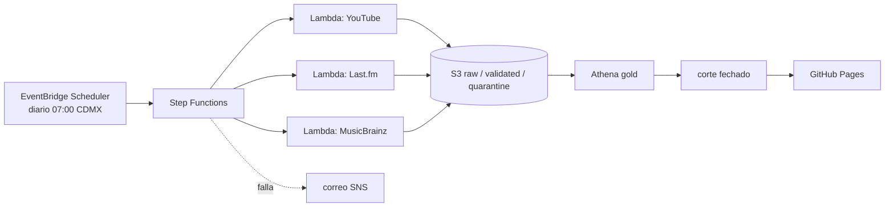

# Termómetro de comebacks

[English](README.md) · **Español**

¿Qué tan fuerte arrancó cada comeback de TWICE, NMIXX y tripleS, comparado con los anteriores del mismo grupo? YouTube muestra totales históricos, que siempre favorecen a los éxitos viejos. Este proyecto toma una foto diaria de los contadores para medir un lanzamiento al día 1, 7 y 28.

**Sitio:** llega en la fase 3. **Estado:** fase 1 de 3, ingesta con contratos de datos.

## Arquitectura



Es la modernización de [mi versión de 2023](https://github.com/Proggleb/youtube_data_engineering_project) (EC2 + RDS + Tableau). Por qué cambió: [ADR 1](docs/adr/0001-serverless-batch-instead-of-ec2-rds.md). Alcance: [RFP](docs/rfp.md) y [SOW](docs/sow.md).

## Lo que sí es y lo que no

- Mide atención en YouTube y Last.fm, no ventas, posiciones en charts ni streams en otras plataformas.
- Los usuarios de Last.fm son sobre todo occidentales; el consumo en Corea está subrepresentado.
- Los valores al día N solo existen para videos publicados después de la primera foto. Los comebacks anteriores se muestran, pero no se comparan.
- No incluye sub-unidades ni lanzamientos en solitario.

## Despliegue

Requiere una cuenta AWS free tier, AWS CLI y Python 3.14.

```bash
aws ssm put-parameter --type SecureString --name /comeback-thermometer/youtube-api-key --value <key>
aws ssm put-parameter --type SecureString --name /comeback-thermometer/lastfm-api-key --value <key>
ALERT_EMAIL=tu@correo.com ./scripts/deploy.sh
```

Confirma el correo de SNS y corre una vez a mano: `aws stepfunctions start-execution --state-machine-arn <PipelineArn>`.

Pruebas: `pip install -r requirements-dev.txt && pytest && cfn-lint`.
