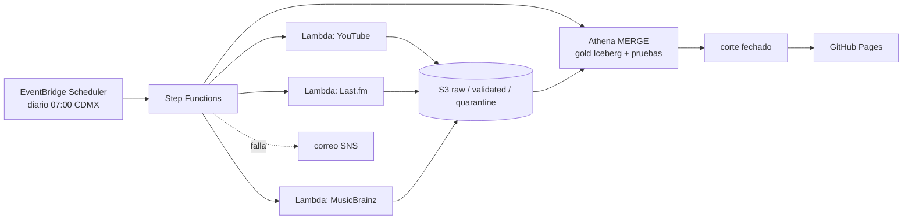

# Termómetro de comebacks

[English](README.md) · **Español**

¿Qué tan fuerte arrancó cada comeback de TWICE, NMIXX y tripleS, coreano o japonés, comparado con los anteriores del mismo artista? Incluye las unidades (MISAMO de TWICE y las de tripleS) y los lanzamientos en solitario de NAYEON, JIHYO, CHAEYOUNG y TZUYU. YouTube muestra totales históricos, que siempre favorecen a los éxitos viejos. Este proyecto toma una foto diaria de los contadores para medir un lanzamiento al día 1, 7 y 28.

**Sitio:** llega en la fase 3. **Estado:** fase 2 de 3: ingesta diaria con contratos de datos y tablas gold en Athena ([ADR 4](docs/adr/0004-gold-iceberg-tables-rebuilt-with-merge.md)).

## Arquitectura



Es la modernización de [mi versión de 2023](https://github.com/Proggleb/youtube_data_engineering_project) (EC2 + RDS + Tableau). Por qué cambió: [ADR 1](docs/adr/0001-serverless-batch-instead-of-ec2-rds.md). Alcance: [RFP](docs/rfp.md) y [SOW](docs/sow.md).

## Lo que sí es y lo que no

- Mide atención en YouTube y Last.fm, no ventas, posiciones en charts ni streams en otras plataformas.
- Los usuarios de Last.fm son sobre todo occidentales; el consumo en Corea está subrepresentado.
- Los valores al día N solo existen para videos publicados después de la primera foto. Los comebacks anteriores se muestran, pero no se comparan.
- Cada lanzamiento se compara solo con los del mismo artista para el mismo mercado (Corea o Japón): un MV japonés o un debut en solitario no se mide contra un sencillo principal de TWICE.
- Solo cubre unidades y solistas con un MV oficial en los canales de las agencias. Last.fm se omite para las unidades con nombres genéricos (Aria y Sun, Moon, Neptune y Zenith de msnz), porque devolvería a otro artista, y para las que Last.fm no tiene registradas (+(KR)ystal Eyes).

## Despliegue

Requiere una cuenta AWS free tier, AWS CLI y Python 3.14.

```bash
read -rs KEY && aws ssm put-parameter --type SecureString --name /comeback-thermometer/youtube-api-key --value "$KEY"
read -rs KEY && aws ssm put-parameter --type SecureString --name /comeback-thermometer/lastfm-api-key --value "$KEY"
unset KEY
ALERT_EMAIL=tu@correo.com ./scripts/deploy.sh
```

Confirma el correo de SNS y corre una vez a mano: `aws stepfunctions start-execution --state-machine-arn <PipelineArn>`. Consulta los resultados en la consola de Athena, workgroup `comeback-thermometer`, tablas `gold_mv_launch` y `gold_artist_daily`.

Pruebas: `pip install -r requirements-dev.txt && pytest && cfn-lint`.
