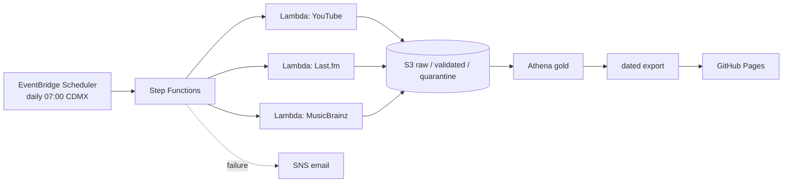

# Comeback Thermometer

**English** · [Español](README.es.md)

How strong was the start of each TWICE, NMIXX and tripleS comeback, Korean or Japanese, compared with the artist's previous ones? Units (TWICE's MISAMO and tripleS's) and the solo releases of NAYEON, JIHYO, CHAEYOUNG and TZUYU are included. YouTube shows lifetime totals, which always favour old hits. This project snapshots the counters every day so a launch can be judged at day 1, 7 and 28.

**Site:** coming in phase 3. **Status:** phase 1 of 3, ingestion with data contracts.

## Architecture



A modernization of [my 2023 version](https://github.com/Proggleb/youtube_data_engineering_project) (EC2 + RDS + Tableau). Why it changed: [ADR 1](docs/adr/0001-serverless-batch-instead-of-ec2-rds.md). Scope: [RFP](docs/rfp.md) and [SOW](docs/sow.md).

## What it is and what it isn't

- It measures attention on YouTube and Last.fm, not sales, chart positions or streams on other platforms.
- Last.fm users skew toward Western listeners; Korean domestic listening is under-represented.
- Day-N values exist only for videos released after the first snapshot. Older comebacks are shown but not ranked.
- Each release is compared only with the same artist's releases for the same market (Korea or Japan): a Japanese MV or a solo debut is not measured against a TWICE title track.
- Only units and soloists with an official MV on the label channels are covered. Last.fm is skipped for units with generic names (Aria, msnz's Sun, Moon, Neptune and Zenith), where it would return another artist.

## Deploy

Requires an AWS free-tier account, the AWS CLI and Python 3.14.

```bash
aws ssm put-parameter --type SecureString --name /comeback-thermometer/youtube-api-key --value <key>
aws ssm put-parameter --type SecureString --name /comeback-thermometer/lastfm-api-key --value <key>
ALERT_EMAIL=you@example.com ./scripts/deploy.sh
```

Confirm the SNS email, then run once by hand: `aws stepfunctions start-execution --state-machine-arn <PipelineArn>`.

Tests: `pip install -r requirements-dev.txt && pytest && cfn-lint`.
